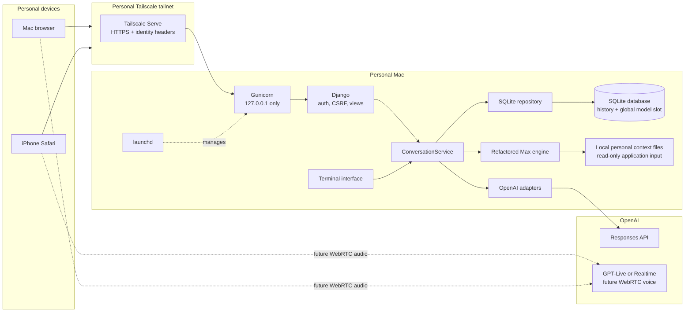
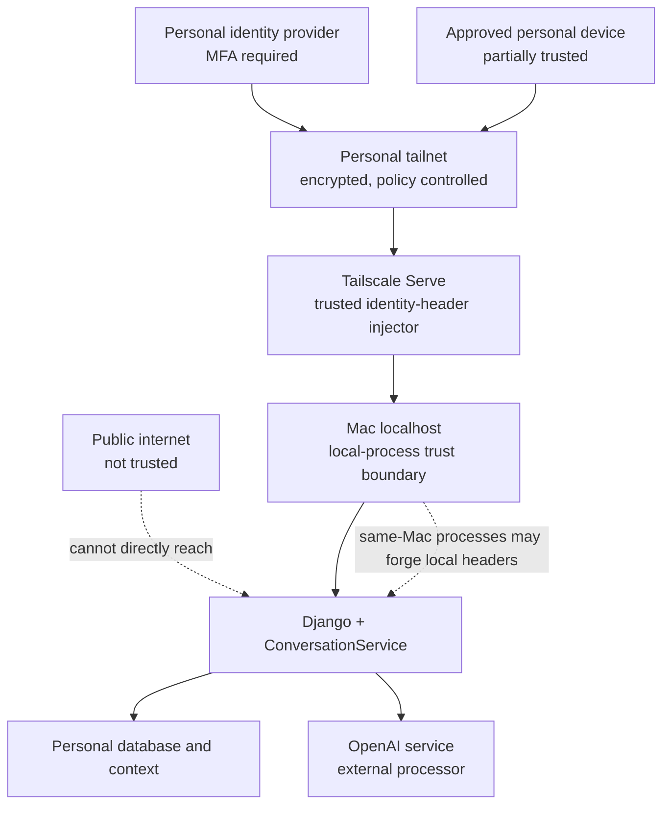
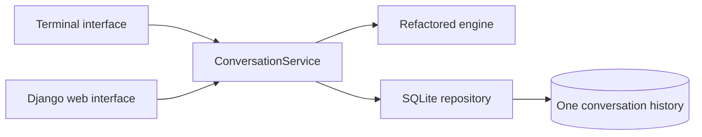
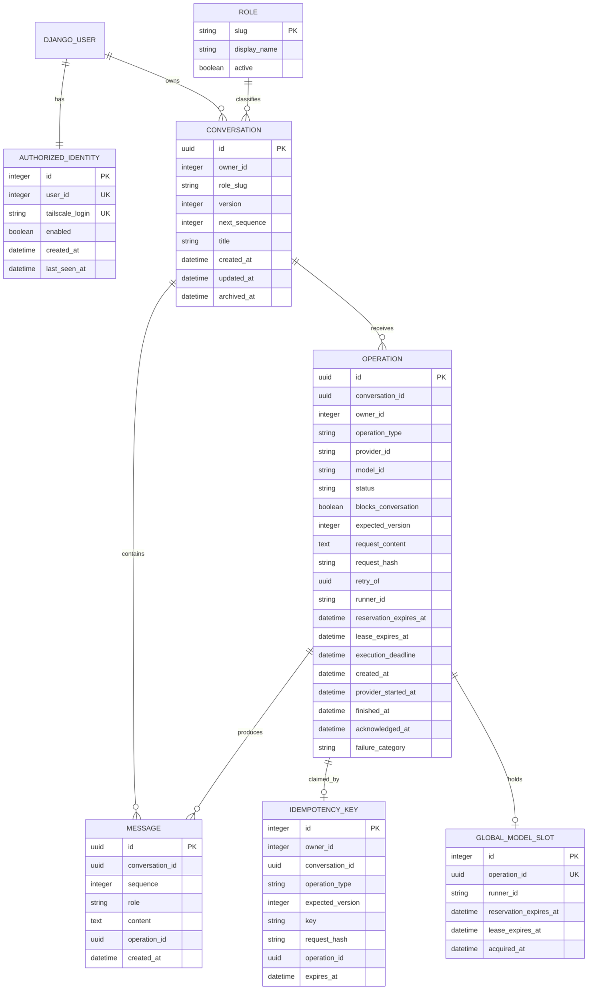
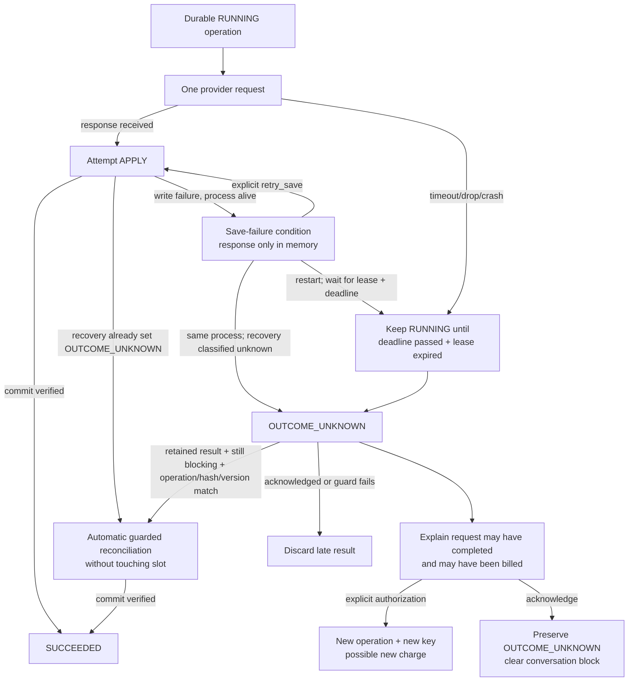
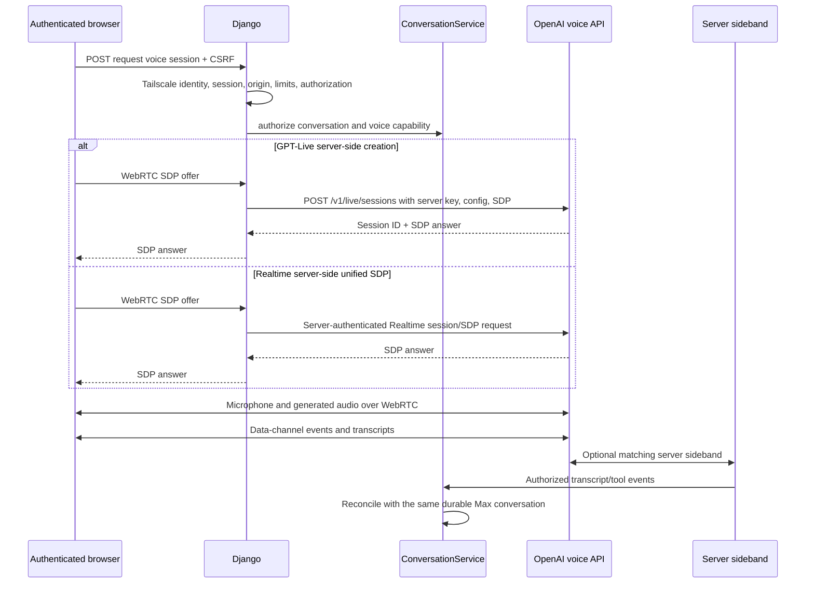

# Personal AI Workforce — Stage 3 Secure Web Architecture

**Status:** Authoritative design blueprint; no web implementation exists yet

**Implementation baseline:** `bb55966`

**Source check:** 2026-10-31

**First release:** Secure text chat for Max Smart

**Reserved future direction:** Natural speech-to-speech voice using a reviewed OpenAI GPT-Live or Realtime WebRTC flow

This document defines how Max Smart should move from the current Terminal application to a secure web application available from Adam's personal Mac and iPhone. It supplements, and does not replace, `docs/architecture.md`.

The architecture is deliberately small: one owner, one personal Mac, one Django process, one SQLite database, one active role, and no consequential-action tools. It creates boundaries that later agents and voice can reuse without introducing PostgreSQL, React, Redis, a job queue, or a second conversation history in Version 1.

## 1. Executive summary

Version 1 will run on Adam's personal Mac. Gunicorn will serve Django only on `127.0.0.1`; Tailscale Serve will terminate tailnet HTTPS and proxy private requests to that loopback listener. Only Adam's exact personal Tailscale login is authorized. Django will verify the Tailscale identity header on every protected request and maintain a server-side application session, but Tailscale device removal or policy changes—not Django logout—are the real network-identity revocation mechanism.

Django server-rendered templates and minimal JavaScript provide one responsive, same-origin interface for Mac Safari and iPhone Safari. Conversation pages never need browser-held API credentials or cross-origin API tokens. Model output is rendered as escaped plain text.

SQLite is appropriate for the expected single-user workload. It allows only one writer at a time, so all transactions must be short. The model request is made only after the PREPARE transaction commits and before the APPLY transaction begins. No database lock remains open while waiting for OpenAI.

The current mutable `MaxSmartApplication` cannot be shared by HTTP requests. Its domain rules will be refactored into serializable, operation-scoped transitions invoked by a `ConversationService`. Both the web and Terminal interfaces must use that service and the same SQLite repository. The existing JSON conversation will be imported once and preserved until the result is verified.

Every submitted message receives an application idempotency key, request fingerprint, expected conversation version, and durable operation record. These prevent duplicate local processing, but they do not guarantee exactly-once provider execution or billing. A timeout, dropped connection, or server crash can leave the provider outcome unknown. Such operations are never automatically replayed.

Text requests will initially execute synchronously in one controlled Gunicorn worker process with a small thread pool. A database-enforced global model slot allows only one application-owned live model request across the Terminal and web processes at a time; neither interface may bypass it. After deadline and lease expiry, recovery cannot prove that an externally stalled provider request has stopped, so rare provider-side overlap remains an acknowledged uncertainty. Progressive JavaScript uses a short PREPARE POST, a separate synchronous execution POST, and authorized polling; the non-JavaScript fallback waits for execution and then follows a redirect. No separate background worker or external queue is introduced.

Future Option B voice will use browser WebRTC only after text, persistence, and security are stable. The two documented candidates are distinct: GPT-Live and Realtime use separate server-side SDP/session flows, identifiers, sideband endpoints, event schemas, and billing behavior. The browser receives an SDP answer, never an API credential. Audio will travel between the personal device and OpenAI, not exclusively on the Mac. The permanent project key, tools, permissions, and consequential-action approvals remain server-side.

## 2. Decisions and verification status

| Area | Version 1 decision | Status |
|---|---|---|
| Hosting | Local-first on Adam's personal Mac | Approved |
| Availability | Mac must be awake, logged in after a FileVault restart, and online | Accepted limitation |
| Private access | Tailscale Serve | Approved |
| Public access | Prohibited; Funnel and public ports are forbidden | Approved |
| Backend | Django 5.2 LTS on Python 3.13, pinned to the latest compatible security patch | Approved, with release-support check before installation |
| Frontend | Server-rendered Django templates with minimal progressive JavaScript | Approved |
| Database | SQLite on a local disk, WAL mode, `synchronous=FULL`, short `IMMEDIATE` transactions where appropriate | Approved, with deployed-version tests |
| Web server | Gunicorn 22 or later; one controlled worker process with a small thread pool, bound to loopback | Approved, with WSGI/timeout/load verification |
| Authentication | Exact personal Tailscale identity plus server-side Django session | Approved |
| Engine boundary | `ConversationService` around refactored serializable engine transitions | Approved |
| Text API | OpenAI Responses API through the existing adapter | Approved |
| Provider retries | One provider call per explicit attempt; SDK automatic retries disabled | Approved design; verify against the pinned SDK |
| Initial model deadline | 180 seconds overall | Candidate default, not final until GPT-5.6 Sol p95/p99 and end-to-end tests |
| PostgreSQL | Migration option only | Deferred |
| React, Redis, external queue, separate background workers | Not part of Version 1 | Rejected for Version 1 |
| Application passkey | Possible second factor | Deferred |
| Voice | OpenAI GPT-Live or Realtime speech-to-speech over WebRTC, selected after a future review | Approved future direction |
| Specialist roles | Schema reservation only; only Max is active | Deferred |

### 2.1 Constrained documentation verification

The eight official pages requested for this review confirm the architecture's central claims:

- Tailscale Serve is tailnet-only, uses tailnet access controls, terminates HTTPS for a tailnet name, supplies identity headers, strips incoming forged identity headers, and recommends a localhost-only backend. Funnel is the public alternative and does not carry identity headers. [Tailscale Serve](https://tailscale.com/docs/features/tailscale-serve)
- Tailscale delegates user authentication to an identity provider, associates user and node identities, supports identity-based grants, and describes device approval. MFA therefore belongs at the personal identity provider. [Tailscale identity](https://tailscale.com/docs/concepts/tailscale-identity)
- Django's deployment checklist requires a production server, secret `SECRET_KEY`, `DEBUG=False`, suitable `ALLOWED_HOSTS`, HTTPS, secure CSRF/session cookies, database backups, and reviewed logging. [Django deployment checklist](https://docs.djangoproject.com/en/5.2/howto/deployment/checklist/)
- Django documents SQLite's concurrency limit, lock timeout, `IMMEDIATE` transaction mode, the need for short transactions, and the absence of effective `select_for_update()` support. [Django database reference](https://docs.djangoproject.com/en/5.2/ref/databases/#sqlite-notes)
- OpenAI recommends the Responses API for new text generation. [OpenAI text generation](https://developers.openai.com/api/docs/guides/text)
- OpenAI documents natural speech-to-speech, WebRTC media tracks, data-channel events, interruption, and server controls. Its WebRTC material presents GPT-Live and Realtime flows that must not be mixed. Max uses the documented server-side SDP form of the selected API so the browser receives no API credential. [OpenAI Realtime](https://developers.openai.com/api/docs/guides/realtime), [WebRTC](https://developers.openai.com/api/docs/guides/voice-webrtc?api=realtime), and [server-side controls](https://developers.openai.com/api/docs/guides/voice-server-controls?api=realtime)

The initial constrained source set did **not** confirm every requested operational detail. The subsequent independent review added official Gunicorn and SQLite sources for the specific facts recorded in this document. The following remain explicit implementation gates:

- Tailscale Serve's HTTP proxy timeout and its treatment of `Host` or `X-Forwarded-*` headers.
- Account-specific MFA configuration, device approval, key expiry, Tailnet Lock, pricing, and plan-entitlement details.
- Django 5.2's exact support end date, Python compatibility table, and the claim that built-in CSP begins in Django 6.0.
- Exact SQLite WAL, `synchronous=FULL`, and backup-API behavior on the deployed macOS/Python/SQLite versions.
- Exact pinned Gunicorn release behavior, Tailscale Serve integration, and behavior after a client disconnect.
- The OpenAI Python SDK's current default timeout/retry behavior.
- A Responses API provider-side idempotency feature for this request path; none is documented on the selected text guide, so this design assumes none.
- OpenAI project-budget/cost controls and whether any dashboard limit is an instantaneous hard stop.
- Final GPT-Live/Realtime server-side session expiry, scope, billing, and sideband details for the API selected at the voice milestone.
- Final encrypted backup destination and retention schedule.

These gaps do not change the chosen architecture. Each must be checked against the exact installed product version during its implementation milestone. Until verified, the system must use the conservative behavior specified here.

## 3. System architecture and trust boundaries

### 3.1 System architecture



Relevant personal context and conversation content leave the Mac when sent to OpenAI. Local-first hosting does not mean all processing or data remains on-device.

### 3.2 Boundary responsibilities

| Boundary | Responsibility | Must not do |
|---|---|---|
| Browser | Display escaped content, collect input, hold CSRF token, optionally poll status | Hold the permanent OpenAI key, authorize itself, or execute tools |
| Tailscale | Private reachability, node/user identity, HTTPS termination, tailnet access policy | Replace application authorization or protect a directly exposed backend |
| Django | Validate host/origin, authenticate identity, authorize every object, enforce CSRF and limits | Own conversation state transitions or call a mutable shared engine |
| `ConversationService` | Orchestrate PREPARE/REQUEST/APPLY, idempotency, versions, recovery | Trust browser identity or keep a transaction open during OpenAI |
| Engine | Provider-neutral rules and serializable state transitions | Know HTTP, Django sessions, SQLite paths, Tailscale, or credentials |
| Repository | Transactional persistence and constraints | Make model requests or contain UI behavior |
| OpenAI adapter | One bounded provider request and normalized outcome | Retry automatically, persist application state, or expose raw provider errors |
| launchd/Gunicorn | Process lifecycle and request capacity | Become an authorization mechanism |

### 3.3 Security trust boundaries



The localhost boundary limits remote spoofing; it does not defend against malicious processes already running on the personal Mac. Local Mac processes are inside the trusted host boundary. A compromised process may connect directly to `127.0.0.1`, forge a Tailscale identity header, read application files available to the same account, or steal credentials. Tailscale's external-header stripping does not protect this local path. Operating-system hygiene and, if later justified, a separate least-privileged service account are the controls for this residual risk.

## 4. Request and data flows

### 4.1 Text-message flow

```mermaid
sequenceDiagram
    participant B as Browser
    participant T as Tailscale Serve
    participant D as Django
    participant C as ConversationService
    participant S as SQLite
    participant O as OpenAI Responses API

    B->>T: short PREPARE POST: message + CSRF + idempotency key + version
    T->>D: Proxy + trusted Tailscale identity header
    D->>D: Host, origin, identity, session, authorization, limits
    D->>C: prepare_submission(command)
    C->>S: PREPARE transaction
    S-->>C: durable QUEUED operation; commit
    D-->>B: 201/202 + server operation ID + URLs; no-store
    B->>D: execution POST for issued operation ID
    D->>C: execute(operation ID)
    C->>S: claim slot ownership + mark RUNNING + set deadline/lease; commit
    C->>O: one bounded model request; no DB transaction
    O-->>C: response or normalized failure
    C->>S: APPLY transaction
    S-->>C: messages + version + operation state; commit
    C-->>D: operation result
    D-->>B: operation result
    B->>D: GET status/conversation
    D-->>B: escaped HTML, no-store
```

### 4.2 Progressive polling without a separate background worker

A synchronous execution request and polling can coexist because Gunicorn has several threads:

1. JavaScript sends a short, CSRF-protected PREPARE POST containing the message, idempotency key, and expected conversation version. Inside PREPARE, the server generates the high-entropy operation ID, acquires the global QUEUED reservation, and commits the durable operation.
2. PREPARE returns `201 Created` or `202 Accepted` with the server-generated operation ID, an authorized execution URL, and an authorized status URL. The response uses `Cache-Control: no-store`. The browser never proposes or chooses an operation ID.
3. The browser starts a separate CSRF-protected execution POST for that operation ID without waiting for it to finish, displays a pending state, and polls the operation-ID status URL.
4. The execution POST first atomically adopts the reservation if PREPARE's process restarted, but only while the operation is still `QUEUED` and unexpired. It then assembles context, atomically claims QUEUED-to-RUNNING, and performs REQUEST. A duplicate execution POST observes the existing durable state and must never make another provider call.
5. A second Gunicorn thread serves polling GETs only after authenticating the Tailscale identity/session and authorizing that operation for its owner and conversation. Every polling JSON response includes `Cache-Control: no-store`.
6. Without JavaScript, the ordinary form POST may perform PREPARE and then continue REQUEST/APPLY in that same request before returning `303 See Other`; it does not offer concurrent polling.
7. A refresh or disconnect does not authorize a replay. The durable operation remains discoverable from the conversation.

The operation ID is an object identifier, not an authentication secret. Every execution and polling request performs object-level authorization. An idempotency key is accepted only in the protected PREPARE body; it is never used as a URL, query parameter, or polling identifier. If a duplicate submission resolves to an existing operation, PREPARE returns that existing server-generated operation ID and the browser switches to its authorized status URL.

This is not a background queue: the original request thread performs the work. If the process dies, lease- and deadline-aware recovery classifies the operation; it never unconditionally changes every `RUNNING` operation.

### 4.3 Terminal convergence



The Terminal must not keep writing `data/current_session.json` after web migration. A one-time importer copies the verified conversation into SQLite. The original JSON remains untouched until import, comparison, rollback testing, and user acceptance are complete.

## 5. Tailscale identity and application authentication

### 5.1 Tailnet policy

- Use a personal Tailscale account and personal identity provider only.
- Enable MFA at that identity provider. Tailscale delegates user authentication to the IdP. [Tailscale identity](https://tailscale.com/docs/concepts/tailscale-identity) The exact MFA configuration must be verified in Adam's account.
- Permit only Adam's exact identity and approved personal Mac/iPhone nodes to reach the Max service.
- Do not join employer-managed Palo Alto Networks devices, use a corporate identity, or use a corporate tailnet.
- Require explicit device approval only after verifying that it is enabled and available for Adam's account. The identity documentation confirms how required approval behaves, but not Adam's current configuration or plan entitlement. [Tailscale identity](https://tailscale.com/docs/concepts/tailscale-identity)
- Treat key expiry and Tailnet Lock as desirable controls requiring account-specific configuration and plan verification. Do not claim that either protects Max until that verification is complete.
- Do not share the Serve device with external users. Serve identity headers are also supplied for users who accepted a device share. [Tailscale Serve](https://tailscale.com/docs/features/tailscale-serve)
- Disable Funnel for the device and deny it by policy where supported. The selected Serve page states that Funnel is public, may be enabled by default, and the most recently configured mode controls whether a port is private or public. [Tailscale Serve](https://tailscale.com/docs/features/tailscale-serve)
- Expose no router port, public reverse proxy, or public DNS service.

### 5.2 Header trust

Tailscale Serve adds `Tailscale-User-Login`, `Tailscale-User-Name`, and optionally `Tailscale-User-Profile-Pic`. It removes incoming headers with those names to prevent external spoofing. Tagged-device traffic does not receive user identity headers. [Tailscale Serve](https://tailscale.com/docs/features/tailscale-serve)

Django's identity middleware must:

1. Run after Django session middleware and before protected application views.
2. Reject a protected request with no `Tailscale-User-Login`.
3. Decode the documented RFC 2047 encoding safely if present.
4. Normalize only as the selected identity provider specifies; do not invent case-folding rules for identities.
5. Compare against one configured exact approved login.
6. Resolve that login to one enabled local authorized-identity record.
7. Create or refresh the Django session for that user.
8. Store the authenticated login in the session and reject a later request if the current header differs.
9. Recheck the header and authorization on every protected request.
10. Ignore display name and profile picture for authorization.

The middleware must never accept an identity from a query parameter, form field, cookie, generic proxy header, or untrusted remote address.

Gunicorn must be pinned to version 22 or later and configured with `header_map = "refuse"` so headers containing underscores are rejected rather than mapped ambiguously into WSGI environment names. Acceptance testing through the actual installed Serve path must cover:

- the legitimate `Tailscale-User-Login` header;
- a forged `Tailscale_User_Login` header;
- duplicate and conflicting identity-header spellings and values.

Do not rely only on Serve stripping ordinary forged identity headers. `header_map` is a remote-input control, not a localhost authentication boundary: a malicious process on the Mac can still connect directly to Gunicorn and supply a syntactically valid hyphenated identity header.

### 5.3 Loopback binding and DNS rebinding

Gunicorn binds only to `127.0.0.1`. Tailscale recommends localhost when identity headers authenticate the backend because direct callers could otherwise supply their own values. [Tailscale Serve](https://tailscale.com/docs/features/tailscale-serve)

Loopback alone is insufficient against DNS rebinding and malicious local web content. Django therefore uses:

- `DEBUG = False`.
- `ALLOWED_HOSTS = ["<exact-max-host>.<tailnet>.ts.net"]`.
- `CSRF_TRUSTED_ORIGINS = ["https://<exact-max-host>.<tailnet>.ts.net"]`.
- no wildcard host or origin;
- CSRF middleware on every state-changing endpoint;
- origin checks on the future voice-session endpoint;
- rejection of protected requests without the approved Tailscale identity.

The deployment checklist identifies exact host validation as a security control and warns that wildcards require independent validation. [Django deployment checklist](https://docs.djangoproject.com/en/5.2/howto/deployment/checklist/#allowed-hosts)

For the initial deployment, explicitly set Gunicorn `secure_scheme_headers = {}` and `forwarded_allow_ips = ""`. Leave Django `SECURE_PROXY_SSL_HEADER` unset. Django deliberately sees the local proxy connection as HTTP, while Tailscale Serve remains responsible for browser-facing HTTPS. Do not enable Django `SECURE_SSL_REDIRECT` or HSTS based on an unverified forwarded scheme. Continue to require Secure cookies, the exact HTTPS origin in `CSRF_TRUSTED_ORIGINS`, and browser access only through the HTTPS Serve URL. Verify the complete behavior through the actual installed Serve version before deployment.

### 5.4 Session and logout semantics

The Django session provides application state, CSRF integration, expiry, and a place to bind the current Tailscale login. Proposed defaults are:

- database-backed server-side sessions;
- a `__Host-`-prefixed session-cookie name where Django/browser compatibility is confirmed;
- `Secure=True`, `HttpOnly=True`, `SameSite=Lax`, `Path=/`, and no `Domain` attribute—the requirements for the `__Host-` prefix;
- `CSRF_USE_SESSIONS=True`, so no separate CSRF cookie needs weaker or duplicate host-prefix configuration;
- 12-hour idle expiry and 7-day absolute expiry as proposals;
- session-key rotation at authentication;
- deletion of expired sessions on a schedule.

`SESSION_COOKIE_SECURE=True` is required. With `CSRF_USE_SESSIONS=True`, the CSRF secret remains in the secure server-side session instead of a separate CSRF cookie; if that decision changes, the CSRF cookie must also be Secure and satisfy the chosen host-prefix rules. [Django deployment checklist](https://docs.djangoproject.com/en/5.2/howto/deployment/checklist/#https)

Logout flushes the Django session and cookie. It does not revoke the Tailscale login: the next approved Serve request can authenticate again. Real revocation requires removing the personal device, removing the user, or changing tailnet access policy. A future application passkey may add a second factor but is not required for Version 1.

## 6. Django application security

### 6.1 Production baseline

- Pin Django 5.2 to the latest supported security patch and Python 3.13.
- Before dependency selection, verify from Django's current release support table that 5.2 remains supported and that the chosen patch supports Python 3.13. The selected deployment page is versioned 5.2 but does not itself establish these two facts.
- Use Gunicorn, never `manage.py runserver`; Django says `runserver` is not for production. [Django deployment checklist](https://docs.djangoproject.com/en/5.2/howto/deployment/checklist/#switch-away-from-manage-py-runserver)
- Run `manage.py check --deploy` against production settings and record every result. Warnings corresponding to disabled HSTS and Django HTTPS redirect are expected and consciously accepted for the initial deployment because Gunicorn deliberately sees the loopback Serve connection as HTTP. Their compensating controls are loopback-only backend binding, Serve-only external access, HTTPS-only browser access, Secure cookies, exact trusted origins, and integration tests through the actual proxy/browser path. Verify the exact warning identifiers against the pinned Django release; do not claim all deployment warnings disappear, and accept no unrelated warning without an explicit reason and control.
- Set `DEBUG=False`.
- Load a unique high-entropy `SECRET_KEY` outside source control. Support controlled rotation with `SECRET_KEY_FALLBACKS`, removing old values promptly. [Django deployment checklist](https://docs.djangoproject.com/en/5.2/howto/deployment/checklist/#secret-key)
- Do not install or expose Django admin.
- Serve only collected static application assets; accept no file uploads in Version 1.

### 6.2 Browser controls

Every conversation response uses:

- `Cache-Control: no-store`;
- `Referrer-Policy: same-origin` (proposed);
- `X-Content-Type-Options: nosniff`;
- frame protection through `frame-ancestors 'none'` and Django's clickjacking middleware;
- a restrictive Content Security Policy, initially:

```text
default-src 'self';
base-uri 'none';
object-src 'none';
frame-ancestors 'none';
form-action 'self';
img-src 'self' data:;
font-src 'self';
style-src 'self';
script-src 'self';
connect-src 'self';
media-src 'self';
```

Voice will require a separately reviewed CSP expansion for microphone/WebRTC connections to the documented OpenAI origins. Do not weaken the text application's policy in advance.

The working assumption is that Django 5.2 lacks Django 6.0's built-in CSP facility. Because the selected Django pages do not verify that version boundary, the implementation review must confirm it. If still true, a small custom response middleware will set one static, tested CSP header; no third-party CSP package is needed.

### 6.3 Input, output, CSRF, and logging

- Use standard Django CSRF middleware and `` in every state-changing form.
- Authenticate and authorize every protected view, including polling and error/retry endpoints.
- Restrict methods explicitly: GET observes; POST changes state.
- Set a conservative HTTP request-body limit and a separate 20,000-character message limit. The latter is configurable and counts Unicode code points after normalization.
- Reject NUL characters and invalid text encoding; preserve ordinary Unicode and line breaks.
- Apply per-identity and per-conversation rate limits using SQLite counters and short transactions. Start with proposals in section 16.
- Render model output with normal Django escaping and `white-space: pre-wrap`; never mark it safe.
- Do not render model or user Markdown as HTML in Version 1.
- Never put messages, replies, context, credentials, idempotency keys, or voice tokens in URLs.
- Mark conversation POST fields with `@sensitive_post_parameters`.
- Mark secrets and sensitive local variables with `@sensitive_variables` where relevant.
- Configure logs to contain request IDs, operation IDs, status categories, duration, and counts—not message bodies, model replies, personal context, cookies, authorization headers, API keys, ephemeral credentials, SDP, raw audio, or transcript content.
- Do not configure Django 500/404 error emails. The deployment checklist notes that `ADMINS` and `MANAGERS` can receive error details; that path is inappropriate for personal conversation data. [Django deployment checklist](https://docs.djangoproject.com/en/5.2/howto/deployment/checklist/#error-reporting)
- Show generic user errors and retain no raw provider exception text in browser responses.

## 7. Persistence model

### 7.1 Why SQLite

The initial system has one human user, one Django worker process plus the Terminal interface, short metadata/message writes, and comparatively long network waits during which the database is unlocked. SQLite avoids a second database service and is sufficient if all processes share the global slot and write transactions remain short.

Django warns that SQLite cannot support high concurrency; a lock error means one connection held an exclusive lock while another timed out. Increasing the timeout only waits longer and does not remove the concurrency limit. [Django database reference](https://docs.djangoproject.com/en/5.2/ref/databases/#database-is-locked-errors)

SQLite in WAL mode with `synchronous=FULL` is the Version 1 database decision. SQLite permits only one writer at a time, so this design depends on bounded threads, one database-enforced model request across all Terminal and web processes, and very short write transactions. Official SQLite documentation confirms that WAL requires all processes to remain on one host, permits only one writer, and with `synchronous=FULL` syncs the WAL on every transaction commit. The exact deployed macOS/Python/SQLite behavior must still be tested. The database stays on the Mac's local filesystem, never iCloud Drive, a network share, a cloud-synchronized folder, or any filesystem shared between hosts. [SQLite WAL](https://sqlite.org/wal.html)

Migration to PostgreSQL becomes appropriate when any of these are true:

- real concurrent use or multiple human users are required;
- multiple concurrent Django worker processes, multiple hosts, or multiuser scale are required;
- lock contention is sustained despite short transactions;
- private hosting makes a managed database operationally justified;
- required database features exceed SQLite's safe capabilities.

PostgreSQL carries additional operational burden and is not part of Version 1. Repository code should avoid PostgreSQL-specific behavior so a justified future change remains a migration, not an engine rewrite.

### 7.2 Proposed schema



`django.contrib.auth` may supply the local user row, but no password login is enabled. `django.contrib.sessions` supplies the server-side session table.

`GLOBAL_MODEL_SLOT` is a singleton database reservation and execution lease, not a process-local semaphore. A fresh process-instance `runner_id` identifies the Terminal or Django process that owns it.

- PREPARE creates a short QUEUED reservation with `reservation_expires_at`; no provider deadline or execution lease exists yet.
- The QUEUED-to-RUNNING claim transaction sets `provider_started_at`, `execution_deadline`, and `lease_expires_at` from one durable claim time.
- The adapter derives its overall deadline from that same claim and must never run later than the durable `execution_deadline`.
- `lease_expires_at` is fixed at the execution deadline plus a tested APPLY/recovery and clock-skew margin. It is non-renewable; there is no heartbeat or background lease thread.

Reservation duration, execution deadline, cleanup margin, wall-clock/monotonic handling, and clock-skew assumptions are implementation constants that must be tested.

### 7.3 Constraints and indexes

- `authorized_identity.tailscale_login` is unique; exactly one enabled identity exists in Version 1.
- `role.slug` is unique; only `max-smart` is active.
- `conversation.version >= 0`; `next_sequence >= 1`.
- unique `(conversation_id, sequence)` on messages.
- message role is constrained to approved values such as `user` and `assistant`.
- unique `(operation_id, role)` prevents duplicate user or assistant messages for an operation.
- unique `(owner_id, key)` on idempotency keys; the stored binding also includes conversation, operation type, expected version, and request fingerprint.
- idempotency row and operation have a one-to-one mapping.
- every model operation records the exact provider and model identifier used; linked messages inherit that visible provenance.
- partial unique index on `operation(conversation_id)` where `blocks_conversation = true`, so only one unresolved active operation exists per conversation, including a save failure or unacknowledged unknown outcome.
- exactly one singleton global model-slot row may be occupied, and it refers to exactly one operation and `runner_id`; Terminal and Django use the same row and neither may bypass it.
- indexes on `(conversation_id, created_at)`, `(conversation_id, status)`, `operation(created_at)`, and `idempotency_key(expires_at)`.
- foreign keys use restrictive deletion by default. Archiving is preferred to cascading deletion.

SQLite does not implement effective `SELECT ... FOR UPDATE`; Django documents that calling it has no effect. [Django database reference](https://docs.djangoproject.com/en/5.2/ref/databases/#queryset-select-for-update-not-supported) Correctness therefore comes from unique constraints, `IMMEDIATE` transactions, and conditional updates—not assumed row locks.

### 7.4 Transaction rules

- Use explicit short `transaction.atomic()` blocks around PREPARE, QUEUED-to-RUNNING claim, terminal/recovery transitions, ordinary APPLY, and late-result reconciliation.
- Configure Django's SQLite backend with `transaction_mode="IMMEDIATE"` for these write transactions.
- Explicitly enable WAL and `synchronous=FULL`; verify both effective pragma values on every application process at startup and in deployment tests.
- Do not enable `ATOMIC_REQUESTS`; Django discourages it with `IMMEDIATE` because all such transactions should be as short as possible. [Django database reference](https://docs.djangoproject.com/en/5.2/ref/databases/#transactions-behavior)
- Configure a finite SQLite lock timeout and treat exhaustion as a controlled busy result; a larger timeout is not a concurrency solution.
- Do not perform network I/O, model calls, template rendering, or slow context assembly inside a transaction.
- Use optimistic conditional conversation updates (`WHERE version = expected_version`) and reject stale versions.
- Require exactly one affected row for every conditional QUEUED-to-RUNNING transition, conversation-version update, model-slot acquisition/release, recovery transition, and operation completion. Zero rows is a conflict, stale worker, or lost lease; more than one is an integrity failure. Neither condition may be ignored.
- Every write path is transactional and protected by database constraints.
- Treat commit errors as potentially ambiguous. Re-read the operation before attempting another write.

## 8. ConversationService and engine refactor

### 8.1 Smallest safe design

Do not wrap the existing `submit_message()` call with a database transaction. That call currently combines model request and save and has in-memory Pending/Unsaved states, so it cannot expose a durable boundary before the request.

Refactor the engine into provider-neutral, immutable transition functions:

- prepare and validate a request from a serialized conversation snapshot;
- build the provider-neutral model input;
- apply a normalized model outcome to produce a proposed new snapshot.

`ConversationService` owns persistence sequencing, identity/ownership inputs, idempotency, operation states, and repository transactions. The engine remains the single source of domain rules. The service does not duplicate Terminal behavior; both Terminal and Django call the same authoritative service and database repository.

A file-repository adapter may exist only as a temporary migration bridge. It must not accept independent writes after the Terminal moves to SQLite and must not create permanently divergent Terminal and web histories.

### 8.2 Interface contracts

These signatures are illustrative contracts, not implementation:

```python
@dataclass(frozen=True)
class SubmitCommand:
    actor_id: int
    conversation_id: UUID
    expected_version: int
    idempotency_key: str
    message: str

@dataclass(frozen=True)
class PreparedOperation:
    operation_id: UUID
    request_hash: str

@dataclass(frozen=True)
class ClaimedOperation:
    operation_id: UUID
    request_hash: str
    runner_id: str
    execution_deadline: datetime

@dataclass(frozen=True)
class ModelOutcome:
    kind: Literal["success", "definite_failure", "uncertain"]
    output_text: str | None
    public_error_code: str | None

class ConversationService(Protocol):
    def prepare_submission(self, command: SubmitCommand) -> OperationView: ...
    def execute(self, actor_id: int, operation_id: UUID) -> OperationView: ...
    # Convenience path for Terminal and no-JavaScript form submission;
    # internally performs the same durable PREPARE followed by execute.
    def submit_message(self, command: SubmitCommand) -> OperationView: ...
    def get_operation(self, actor_id: int, operation_id: UUID) -> OperationView: ...
    # Valid only when this process still holds a successful provider result
    # whose APPLY transaction failed.
    def retry_save(self, actor_id: int, operation_id: UUID) -> OperationView: ...
    def acknowledge_unknown(
        self, actor_id: int, operation_id: UUID
    ) -> OperationView: ...
    def start_explicit_retry(
        self, actor_id: int, prior_operation_id: UUID, new_idempotency_key: str
    ) -> OperationView: ...

class ConversationRepository(Protocol):
    def prepare(self, command: SubmitCommand) -> PreparedOperation: ...
    def adopt_queued(
        self, actor_id: int, operation_id: UUID,
        new_runner_id: str, now: datetime
    ) -> PreparedOperation: ...
    def claim_running(
        self, actor_id: int, operation_id: UUID,
        new_runner_id: str, claimed_at: datetime
    ) -> ClaimedOperation: ...
    def fail_pre_provider(
        self, operation_id: UUID, runner_id: str,
        failure: FailureCategory
    ) -> OperationView: ...
    def apply_success(
        self, prepared: PreparedOperation, output_text: str
    ) -> OperationView: ...
    def reconcile_late_success(
        self, operation_id: UUID, request_hash: str,
        expected_version: int, output_text: str
    ) -> OperationView: ...
    def apply_failure(
        self, operation_id: UUID, failure: FailureCategory
    ) -> OperationView: ...
    def recover_expired_operations(self, now: datetime) -> RecoveryReport: ...

class MaxConversationEngine(Protocol):
    def prepare(
        self, snapshot: ConversationSnapshot, message: str
    ) -> ModelRequest: ...
    def apply(
        self, snapshot: ConversationSnapshot, message: str, response: str
    ) -> ConversationSnapshot: ...
```

The concrete OpenAI adapter receives a `ModelRequest` and returns one normalized `ModelOutcome`. It knows no database path or browser identity. PREPARE generates every operation ID inside the service. The browser learns it only from the committed PREPARE response and uses it for the separately authorized execution and polling requests; neither browser nor Terminal callers may choose one. These repository signatures are illustrative; the transaction and state-machine rules in sections 7, 9, and 10 remain authoritative.

### 8.3 Provider-specific context budgeting

A provider-specific context manager builds every `ModelRequest`. The complete conversation remains durably stored; the request contains instructions, approved personal context, and the most recent complete conversation turns that fit the selected provider/model budget.

Initial engineering settings, not verified product limits:

| Provider/model | Context/input proposal | Reserved output |
|---|---:|---:|
| Cloud GPT-5.6 Sol | Maximum 24,000 input tokens, subject to verification against the actual model context limit | A separate model-specific output allowance |
| Local GPT-OSS 20B | 8,192-token context window; approximately 6,000 input tokens | Approximately 2,000 tokens |

Rules:

- Count tokens with the selected provider/model tokenizer or use a documented conservative estimate.
- Budget system instructions and approved personal context before selecting history.
- Include recent complete turns; never silently truncate one message.
- Clearly tell Adam when older durable history was omitted from the current request.
- Reject a single message that cannot fit after mandatory instructions and output reservation rather than silently truncating it.
- Any future summary is an explicitly sourced artifact with provenance. It never silently replaces or deletes the source conversation.
- Set Ollama `num_ctx` explicitly for a local request; do not rely on its default.

## 9. Model-request lifecycle

### 9.1 Conversation state is not operation state

A **conversation** contains committed messages, the next message sequence, role, owner, and optimistic version. It may be active or archived. It does not become `RUNNING`, `FAILED`, or `OUTCOME_UNKNOWN`.

An **operation** represents one requested mutation of a conversation. Its durable state is one of:

- `QUEUED` — PREPARE committed, but no provider call has started.
- `RUNNING` — this attempt has crossed the provider-call boundary.
- `SUCCEEDED` — the complete user/assistant turn and new conversation version committed.
- `FAILED` — a definite failure was recorded. It is final and never represents a persistence failure after a successful provider response.
- `OUTCOME_UNKNOWN` — provider execution or billing may have occurred, but no safe final outcome is known.
- `CANCELLED` — the provider boundary was never crossed, including a stale `QUEUED` operation cancelled by recovery.

These operation states must not be reused as conversation states. A separate `blocks_conversation` flag remains true while an operation is unresolved, including a retryable persistence failure or an unacknowledged unknown outcome. Acknowledging an unknown outcome preserves the `OUTCOME_UNKNOWN` historical state and warning metadata; it only clears `blocks_conversation` after Adam has seen the warning.

### 9.2 PREPARE, REQUEST, APPLY

```mermaid
stateDiagram-v2
    [*] --> QUEUED: PREPARE commits
    QUEUED --> CANCELLED: expired reservation before provider start
    QUEUED --> FAILED: definite pre-provider failure
    QUEUED --> RUNNING: claim attempt; commit
    RUNNING --> SUCCEEDED: APPLY commits
    RUNNING --> FAILED: definite failure recorded
    RUNNING --> OUTCOME_UNKNOWN: deadline passed and lease expired
    OUTCOME_UNKNOWN --> SUCCEEDED: retained result; still blocking + identity/hash/version match
    OUTCOME_UNKNOWN --> OUTCOME_UNKNOWN: acknowledge warning; unblock only
    SUCCEEDED --> [*]
    FAILED --> [*]
    CANCELLED --> [*]
```



#### PREPARE

In one short `IMMEDIATE` transaction:

1. Confirm actor identity, conversation ownership, role, and authorization.
2. Validate message length and current conversation version.
3. Normalize the command and compute a cryptographic request fingerprint over owner, conversation, operation type, expected version, role, and exact message content.
4. Look up the idempotency key for that complete binding: owner, conversation, operation type, expected version, and request fingerprint.
5. If the key exists with a different hash, reject with `422 Unprocessable Content`.
6. If it exists with the same hash, return the existing operation without another model call.
7. Inspect the singleton slot before acquiring it. If it is occupied, run the shared inline recovery rules in this same transaction: an expired QUEUED reservation becomes `CANCELLED`; a RUNNING operation becomes `OUTCOME_UNKNOWN` only when both its fixed lease and execution deadline have expired. Conditionally release the old slot and require exactly one affected row.
8. If the occupied slot is live or not yet recoverable, roll back and return a clear **Max is busy** result. Create no operation or idempotency row.
9. Ensure no blocking operation exists for this conversation after any recovery transition.
10. Generate a fresh operation ID on the server and atomically acquire the singleton slot as a short QUEUED reservation for that ID and this process's `runner_id`.
11. Create the idempotency row and operation with request content, expected version, fingerprint, `runner_id`, `reservation_expires_at`, `blocks_conversation=true`, and status `QUEUED`. `provider_started_at`, `execution_deadline`, and `lease_expires_at` remain null.
12. Require exactly one row to be affected by slot acquisition and commit before any provider work.

PREPARE is identical for Terminal and web. A process-local semaphore may reduce accidental local contention, but it is not the correctness control and cannot replace the database slot.

#### REQUEST

Outside every database transaction:

1. At EXECUTE entry, use one short `IMMEDIATE` transaction to read the recorded reservation owner. Require the operation to remain `QUEUED`, require `reservation_expires_at > now`, and require the slot to contain the same operation ID and recorded runner. If the executing process has a different `runner_id`, atomically transfer both the QUEUED operation and slot to that new runner, requiring exactly one affected row for each conditional transfer. This permits execution after a PREPARE-process restart without allowing takeover of RUNNING or expired work. If the runner already matches, verify ownership without rewriting it.
2. Load only the context authorized for Max and this conversation, using the provider-specific context budget.
3. Build the same provider-neutral request for Terminal or web.
4. If context files cannot be loaded, authorized context assembly fails, the provider-specific budget cannot be satisfied, or model configuration validation fails, record a definite pre-provider failure as described below. Do not call the provider.
5. In one short `IMMEDIATE` transaction, choose one claim time; verify that the operation remains `QUEUED`, its reservation is unexpired, and the operation and slot both belong to this operation ID and current `runner_id`; atomically change exactly one operation row to `RUNNING`; and set `provider_started_at`, `execution_deadline`, and the fixed non-renewable `lease_expires_at`. The lease covers the durable execution deadline plus the fixed cleanup/recovery margin.
6. Derive the adapter's overall request deadline from that exact claim time. It must never exceed the durable `execution_deadline`.
7. Make at most one provider request for this explicit attempt, with no database transaction or lock open.
8. Disable SDK automatic retries with `max_retries=0`, after verifying the pinned SDK's exact configuration.
9. Normalize the response or error without exposing provider details.

For a definite failure after PREPARE but before the provider boundary, one short transaction conditionally changes exactly one `QUEUED` operation to final `FAILED`, records a pre-provider failure category, clears `blocks_conversation`, and releases exactly the matching slot row by operation ID and `runner_id`. Validation failures before PREPARE still create no operation.

If EXECUTE arrives after `reservation_expires_at`, it must not adopt, claim, assemble context, or call the provider. In the EXECUTE-entry `IMMEDIATE` transaction, if the operation is still `QUEUED`, conditionally change it to `CANCELLED`, clear `blocks_conversation`, and release exactly the matching slot row using its recorded runner; then return the explicit result **operation expired—resubmit**. If recovery already made the transition, return the same result from the durable `CANCELLED` state. A client may resubmit only through a new PREPARE request with a new idempotency key.

#### Ordinary successful APPLY: `RUNNING → SUCCEEDED`

In one short transaction:

1. Re-read the operation.
2. If it is already `SUCCEEDED`, return its result.
3. Require the operation ID, actor, conversation, request hash, and expected version to match; require status still to be `RUNNING`; and require the operation's `runner_id` to match the current process instance.
4. Require the singleton slot's operation ID and `runner_id` to match this operation and process.
5. Conditionally update the conversation only where `version = expected_version`.
6. Insert the user and assistant messages with consecutive sequence numbers linked to the operation.
7. Increment `next_sequence` and conversation version.
8. Mark the operation `SUCCEEDED`, clear `blocks_conversation`, and release the matching global slot in the same transaction.
9. Require exactly one affected row for every conditional operation, conversation, and slot update; commit atomically.

If the version no longer matches, do not silently merge. Return a conflict and investigate, because the active-operation constraint should normally have prevented it.

#### Late-result reconciliation: `OUTCOME_UNKNOWN → SUCCEEDED`

This is a persistence reconciliation, not an ordinary APPLY and not another provider request. In one short transaction it may commit a retained successful response only when all of these remain true:

- this process still holds the immutable successful result for the exact operation ID and request fingerprint;
- the operation is `OUTCOME_UNKNOWN`, has not been acknowledged, and still has `blocks_conversation=true`;
- the conversation's active blocking operation is still this exact operation; with the proposed schema, the partial unique blocking-operation constraint and an explicit query establish that no newer operation owns the conversation;
- the conversation still has the operation's `expected_version`.

The reconciliation conditionally inserts the turn, advances the conversation version, marks the operation `SUCCEEDED`, and clears its block. It does **not** acquire, release, inspect for ownership, or otherwise modify the global model slot, which may now belong to another operation. Every conditional update must affect exactly one row.

Once Adam acknowledges the unknown outcome, or if any ownership/hash/version/blocking condition fails, the late result is discarded and can never modify conversation history.

If an original model request returns after recovery has already changed its operation to `OUTCOME_UNKNOWN`, the service automatically attempts this guarded late-result reconciliation instead of requiring Adam to invoke `retry_save`. The automatic attempt uses the response already held by that request, performs no provider call, and applies every guard above. Success commits the retained turn; failure or prior acknowledgement discards it. It never reads, acquires, releases, or changes the global model slot.

Every slot release is conditional on the same operation ID and `runner_id`, must affect exactly one slot row, and occurs only with a verified execution-terminal classification. `OUTCOME_UNKNOWN` is terminal for provider execution—no replay occurs—although a guarded persistence reconciliation may later correct it to `SUCCEEDED` without another provider call:

- `SUCCEEDED` releases it in the APPLY commit;
- a definite pre-provider or provider failure releases it and clears `blocks_conversation` in the same commit that records final `FAILED`;
- stale `QUEUED` recovery releases it and clears `blocks_conversation` in the same commit that records `CANCELLED`;
- expired `RUNNING` recovery releases it in the same commit that records `OUTCOME_UNKNOWN`, only after both lease and deadline checks pass.

A save-failure overlay does not release the slot while the durable operation remains `RUNNING`. Late-result reconciliation after recovery is the sole path here that does not touch the slot.

### 9.3 Concurrent tabs and devices

- Two submissions with the same idempotency key and same content observe one operation.
- The same key reused for another owner, conversation, operation type, expected version, or request content is rejected.
- Two different keys against the same conversation race in PREPARE; the active-operation constraint allows one and returns `409 Conflict` for the other.
- A stale tab with an old conversation version receives `409 Conflict` and reloads before resubmitting.
- A new submission against any conversation receives **Max is busy** and creates no operation while the global slot is occupied.
- The singleton database slot, not a process-local semaphore, limits Terminal and web together to one application-owned live model operation. After deadline and lease expiry, a severely stalled or sleeping old process may still leave OpenAI processing externally even though recovery has released the application slot; the stale-write guards prevent it from corrupting history, but the design cannot promise that external provider execution never overlaps in that rare case.
- SQLite serializes the brief writes. Readers and polling must not begin long transactions.
- Refresh uses GET and never resubmits. The no-JavaScript path uses POST-Redirect-GET; the JavaScript path uses the committed operation ID and authorized GET polling rather than repeating either POST.
- Polling uses the authorized operation ID. It never places the idempotency key in a URL.

Suggested idempotency retention is 30 days. Cleanup deletes expired idempotency rows only after their operations are terminal and outside the active recovery window. Retention is configurable.

## 10. Failure and recovery

### 10.1 Outcome classification

| Situation | State | Automatic model retry? | User action |
|---|---|---:|---|
| Validation, authorization, version, limit, or busy result before PREPARE commits | No operation | No | Correct request, reload, or wait for Max |
| Definite context, budget, or model-configuration failure after PREPARE but before provider start | `FAILED` with a pre-provider category; slot released | No | Correct configuration/context or submit a new operation |
| Provider explicitly rejects and non-execution is known | `FAILED` with a definite-provider category | No | May authorize a new operation |
| Complete response and successful database commit | `SUCCEEDED` | No | None |
| Timeout, connection loss, or process crash during REQUEST | Remains `RUNNING` until both the enforced deadline has passed and the lease has expired; then `OUTCOME_UNKNOWN` | Never | Read warning; explicitly authorize a new attempt |
| Client disconnect while REQUEST continues | Remains observable in its current durable state; the original thread may complete | Never | Poll or revisit the conversation |
| Stale `QUEUED` operation whose provider boundary was never crossed | `CANCELLED` during recovery | No | Submit a new operation |
| Model response received but APPLY cannot commit | Immutable in-memory save-failure overlay; durable operation remains `RUNNING` if it cannot safely be changed | Never | Retry only the save |
| APPLY raises after an ambiguous commit result | Reconcile from database first | Never | Observe; do not duplicate messages |

An HTTP 4xx is not automatically a definite provider non-execution guarantee. The adapter must classify only outcomes for which the provider contract makes that conclusion safe. Everything else is uncertain.

### 10.2 Unknown-outcome recovery



Recovery is lease-aware and runs only at controlled process startup and inline in PREPARE before a new operation acquires the global slot. Terminal and Django call the same repository recovery routine. There is no scheduled/background recovery worker. Recovery never sends a provider request and never sweeps all `RUNNING` rows unconditionally:

- A `QUEUED` operation is stale only when its slot reservation has expired and `provider_started_at` is absent. Recovery then changes it to `CANCELLED`, releases its slot in the same verified commit, and knows it did not cross the provider boundary.
- A `RUNNING` operation remains untouched while its lease is live or its enforced execution deadline has not passed.
- Only after both the lease has expired and the deadline has passed may recovery mark `RUNNING` as `OUTCOME_UNKNOWN` and release the slot in the same verified commit.
- A live operation owned by another Terminal or Django process must never be mistaken for abandoned work.
- Inline takeover classifies the old operation and conditionally releases the old slot before acquiring it for the new operation, all in one `IMMEDIATE` transaction with exact affected-row checks.

A lease is an application recovery mechanism, not proof that OpenAI has stopped processing. Mac sleep or a severe process stall can allow the durable deadline and lease to expire while an external request remains uncertain. Recovery may then permit another application request, so rare external overlap and a duplicate charge remain possible. Conditional status, runner, slot, blocking-operation, fingerprint, and version checks prevent the stale process from writing over newer history. Ambiguous requests are never replayed automatically; an explicit retry remains a new operation and may incur another charge.

The UI states:

> Max may have completed this request, but the application did not safely record the outcome. Retrying will send a new request and may incur another charge.

The acknowledge POST is enabled only after this warning has been rendered for the authorized owner. It records `acknowledged_at`, preserves status `OUTCOME_UNKNOWN` and all historical metadata, and only then clears `blocks_conversation`.

Application idempotency prevents duplicate submissions to this application. It is not provider idempotency and cannot promise exactly-once execution or billing. The selected OpenAI text guide documents the Responses API but no applicable provider idempotency mechanism for this path. Therefore Version 1 assumes no such guarantee. [OpenAI text generation](https://developers.openai.com/api/docs/guides/text)

### 10.3 Cancellation and stopping browser wait

- A stale `QUEUED` operation can be cancelled safely by recovery before the provider boundary and becomes `CANCELLED`.
- Once the operation is `RUNNING`, Version 1 offers no user cancellation. The browser may stop waiting, but the provider request and original worker thread continue.
- A browser disconnect never changes operation state and never triggers a replay.
- An explicit retry creates a **new operation**, new idempotency key, and separate provider request. It can incur an additional charge even if the earlier request completed.
- Cancellation does not roll back an already committed `SUCCEEDED` turn.

### 10.4 Save failure

If a model response has been received but SQLite cannot commit:

- keep an immutable proposed snapshot in a process-memory map keyed by operation ID;
- return/display a distinct save-failure condition without exposing the assistant reply as committed history;
- do not mark the operation `FAILED`; keep the durable operation `RUNNING` if it cannot safely be updated;
- permit only `retry_save(operation_id)`;
- never repeat REQUEST as part of save retry;
- before retrying, re-read the database in case the earlier commit actually succeeded;
- remove memory only after a verified commit or an explicit shutdown warning.

`retry_save` is valid only when the current process still holds the immutable successful provider result produced by that same operation, the operation ID and request fingerprint match, the expected conversation version still matches, and the only failed phase was persistence. It retries persistence only and never calls the model. While status is `RUNNING`, it uses ordinary APPLY and must still own the matching slot. If lease-aware recovery has already classified the operation `OUTCOME_UNKNOWN`, it uses the separate late-result reconciliation rules above: the operation must remain unacknowledged and blocking, and it never touches the slot. No other unknown operation may become `SUCCEEDED`. A definite pre-provider or provider failure has no successful result to save: `retry_save` must reject it and must never convert it to `SUCCEEDED`. Retrying a definite failure requires a new, explicit provider operation with a new idempotency key.

Memory is not durable. A crash or restart loses the snapshot, and the durable operation may still say `RUNNING`; only after its lease expires and execution deadline passes may recovery mark it `OUTCOME_UNKNOWN`. An encrypted recovery journal is deferred.

## 11. Timeouts, capacity, and process model

### 11.1 Proposed initial process

- Gunicorn 22 or later, pinned to the exact reviewed version;
- one Gunicorn `gthread` worker process;
- a small controlled thread pool, proposed initially as 4 threads so polling and one long request can coexist;
- at most 1 application-owned live model request across all Terminal and web processes, enforced by the singleton SQLite slot; after deadline and lease recovery, an externally stalled provider request may rarely overlap as documented in sections 9.3 and 10.2;
- one active operation per conversation;
- SQLite connections scoped normally per Django thread;
- no external task queue and no separate background worker;
- launchd restarts an unexpectedly exited process, with bounded restart behavior.

Gunicorn's official settings documentation confirms that `timeout` kills workers that are silent, and for non-sync workers it is not tied to the duration of one request. Therefore a `gthread` `timeout` is a worker-liveness control, not the model-request deadline. The final pinned release, client-disconnect behavior, shutdown behavior, and load behavior still require integration tests. Do not depend on defaults. [Gunicorn settings](https://gunicorn.org/reference/settings/)

launchd's process-exit timeout must exceed Gunicorn's configured `graceful_timeout` plus the APPLY/cleanup margin; otherwise launchd could force termination before Gunicorn completes its graceful period. `ExitTimeOut` is the candidate launchd key, but its exact name, units, signal behavior, and support must be verified against the deployed macOS version before writing the plist. Do not rely on an assumed macOS default.

### 11.2 Timeout budget

Proposed starting values, subject to integration testing:

| Layer | Proposed value | Reason |
|---|---:|---|
| Cloud model overall deadline | 180 seconds initially | Adapter-enforced candidate; choose the final value after measuring GPT-5.6 Sol p95/p99 |
| Per-phase HTTP timeouts | Bounded below the overall deadline | Protect connect/read/write/pool phases; not a substitute for the overall deadline |
| Gunicorn worker timeout | Pinned, tested liveness value | Detect a silent worker; not an individual-request duration limit |
| Gunicorn graceful timeout | Greater than model deadline + APPLY/shutdown margin | Allow an in-flight request to finish or leave lease-aware recovery state |
| Browser pending warning | 30 seconds | Explain that work is continuing |
| Poll interval | 2 seconds, back off to 5 seconds | Low single-user overhead |
| SQLite busy timeout | 5 seconds initially | Surface contention rather than hide it |

These are not confirmed product defaults. Tests must establish:

1. the adapter enforces one overall deadline even if the HTTP client exposes only per-phase timeouts;
2. GPT-5.6 Sol p95 and p99 response times under representative prompts are measured before the final deadline is selected;
3. Gunicorn's liveness and graceful-shutdown settings do not kill a healthy request before its deadline and APPLY margin;
4. Serve's measured proxy behavior is recorded rather than assumed compatible;
5. a browser or proxy disconnect does not trigger an automatic replay;
6. the original worker thread can continue and complete, and the operation remains observable through authorized polling from another thread/device;
7. shutdown either finishes within a bounded grace period or leaves lease-aware recovery state;
8. four concurrent polling requests do not starve the model-request thread;
9. SQLite writes remain short under simultaneous polling and submission.

If Serve terminates the long POST first, JavaScript clients can continue authorized polling while the original worker thread completes. The no-JavaScript fallback may degrade because it depends on the long POST surviving. If measured behavior prevents reliable completion or observability, revisit the architecture rather than adding hidden threads or automatic replay.

## 12. Future Option B voice

### 12.1 Product intent

Option B is natural, continuous speech-to-speech:

- Adam speaks normally.
- Max replies with generated speech.
- Adam can interrupt (barge in).
- Conversation continues over multiple turns.
- Text and voice share the same identity, context boundaries, permissions, and durable conversation.

OpenAI describes Realtime as appropriate for low first-audio latency, natural turn-taking, interruptions, and realtime tool use. [OpenAI Realtime](https://developers.openai.com/api/docs/guides/realtime)

### 12.2 Two distinct official WebRTC connection models

The future voice milestone must choose one documented model and implement it consistently. Endpoints, credentials, session IDs, and event schemas are not interchangeable.

| Model | Trusted-server action | Browser action | Credential boundary |
|---|---|---|---|
| GPT-Live WebRTC | Receive the browser's SDP offer and create the media session with `POST /v1/live/sessions`, sending session configuration and SDP with the permanent project key | Send SDP to Django, receive the returned SDP answer, then use WebRTC media tracks/data channel | Permanent key remains on Django; the browser does not receive it |
| Realtime API WebRTC | Receive the browser's SDP offer and use the documented server-side unified SDP/session flow for the selected Realtime API, authenticating to OpenAI with the permanent project key | Send SDP to Django, receive the returned SDP answer, then use WebRTC media tracks/data channel | Permanent key remains on Django; the browser receives no API credential |

The selected official WebRTC guide currently contains GPT-Live, Realtime client-secret, and Realtime server-side/unified examples. Max selects a server-side SDP exchange so no API credential reaches the browser. The architecture must not mix GPT-Live and Realtime endpoints, session responses, identifiers, sideband URLs, event schemas, or billing assumptions. The exact generally available Realtime server-side endpoint and schema must be re-verified at the voice milestone. [OpenAI WebRTC](https://developers.openai.com/api/docs/guides/voice-webrtc?api=realtime)

### 12.3 Future voice flow



In both flows, the browser microphone and speaker use WebRTC media tracks, while a data channel carries session and transcript events. Voice uses the same authenticated Adam identity, `max-smart` role, context boundaries, conversation ID, permission checks, and `ConversationService` as text. Natural turn-taking and interruption are product requirements, not permission shortcuts.

Audio leaves the iPhone or Mac and is transmitted to OpenAI over WebRTC. That transmission is one privacy fact. OpenAI's provider-side logging and retention behavior is a separate privacy consideration that must be verified from the then-current service terms and data-control documentation before voice activation; local non-storage does not imply provider non-retention. Max does not record or persist raw audio by default.

### 12.4 Voice authorization and credential rules

- Voice initialization is a CSRF-protected POST, not a cacheable GET.
- Recheck the Tailscale identity, session binding, exact origin, conversation ownership, role, daily voice allowance, and concurrent-session allowance.
- For GPT-Live, accept a size-limited SDP offer and create the session server-side only after authorization.
- For Realtime, use its documented server-side unified SDP/session flow where supported and configure the permitted model/session server-side.
- Return every session-creation response with `Cache-Control: no-store`.
- Never return a permanent or ephemeral API credential to the browser when server-side SDP exchange is supported.
- Bind a stable privacy-preserving safety identifier in the API-specific session configuration where the selected flow supports it. [OpenAI Realtime](https://developers.openai.com/api/docs/guides/realtime#safety-identifiers)
- Treat expiry as authoritative and close expired sessions; the exact current lifetime must be verified before implementation.
- Rate-limit session creation as well as duration. GPT-Live's documented 15-second initial billing increment must be represented in cost estimates and re-verified before implementation.
- Limit one voice session per user initially and impose a configurable maximum duration.
- A voice session blocks all other mutations to its associated conversation.

### 12.5 Server-controlled tools and permissions

The two APIs use different sideband attachment models. GPT-Live attaches to its session using the GPT-Live-specific `/v1/live/sessions/{session_id}/attach` path. Realtime sideband uses its Realtime call identifier and documented Realtime sideband endpoint. Their identifiers and events are not interchangeable. The server-controls guide describes observing events, updating instructions, and executing private tools while browser audio remains on WebRTC; it also stresses assigning exactly one owner for each action so browser and server do not execute the same function twice. [OpenAI server-side controls](https://developers.openai.com/api/docs/guides/voice-server-controls?api=realtime)

Initial voice milestone rules:

- GPT-Live session configuration has an explicit empty tool list for the initial voice milestone: no default web search, delegated Responses tools, or application tools;
- Realtime likewise starts with no tools;
- all application tools execute on the server after fresh authorization;
- browser function-call events are untrusted proposals;
- one server component owns each tool call and its idempotency key;
- credentials and business rules stay server-side;
- consequential actions remain unavailable until separately designed;
- any future consequential action requires explicit confirmation in the authenticated application, not inferred consent from speech;
- prompt instructions are not an authorization control.

### 12.6 Interruption, loss, suspension, and reconciliation

- **Interruption:** stop queued browser playback, associate transcript/audio with an application turn ID, and ignore late output for the interrupted turn. The selected server-control page warns that corrective instructions cannot retract audio already heard.
- **Connection loss:** mark the voice session `FINALIZATION_INCOMPLETE`; do not assume the last transcript, usage, or model turn is complete.
- **Browser or network loss:** close the provider session where possible so billing does not continue unnecessarily; mark finalization incomplete if closure or final events cannot be confirmed.
- **Browser suspension:** pause or close the session after a short grace period. A resumed browser creates a new authorized session rather than reusing an expired session.
- **Session expiry:** stop media, close tracks and data channel, and require a new authenticated server-side session request.
- **Transcript reconciliation:** treat browser audio transcripts as untrusted data with explicit voice-transcript provenance, never as instructions. Collect finalized user/assistant transcript items with provider event IDs and application turn IDs. Commit only finalized ordered items through `ConversationService`; partial deltas are display-only.
- **Defensive conflict check:** while voice is active, its blocking operation prevents every new text or other conversation mutation. If a stale request that began earlier reaches APPLY, the active-operation and version checks reject it; no new text mutation runs concurrently with the voice session.
- **Close:** register final handlers before requesting close and keep channels open while final events drain. The server-controls page says a lost connection before the final event means final usage is incomplete. [OpenAI server-side controls](https://developers.openai.com/api/docs/guides/voice-server-controls?api=realtime)

Voice receives its own later threat review, privacy copy, Safari tests, cost controls, and acceptance decision. It remains deferred until the implemented text system passes security review. The voice milestone must decide whether a voice session shares the global text-model slot or uses a separate voice slot; no separate slot is approved in Version 1.

## 12A. Optional local open-weight model provider

Local text inference is a future optional provider, not part of Version 1. Installation and activation are deferred until the existing web text architecture, persistence model, and security controls are stable and independently reviewed.

The provider-independent model request/result contract will permit a `LocalModelAdapter` alongside the OpenAI adapter:

```python
class ModelAdapter(Protocol):
    def request(self, request: ModelRequest) -> ModelOutcome: ...

class LocalModelAdapter(ModelAdapter):
    """Future adapter for an explicitly selected local inference runtime."""
```

Ollama is the preferred first runtime candidate, subject to a later implementation and security review. Apple MLX may be benchmarked, but its current basic HTTP server is not a production service without a separate security review. This does not approve installation or activation of either runtime. Before activation:

- bind the inference service only to `127.0.0.1`, with no LAN, tailnet, or public listener;
- pin and record the reviewed runtime version and disable automatic runtime updates;
- pin the exact model name/version and verify model-weight hashes or the strongest provenance mechanism the distribution supports;
- allowlist exact installed model identifiers/tags; no browser, caller, message, or user-supplied model identifier may select another model or trigger a download;
- review the model licence, acceptable-use terms, model card, safety documentation, and redistribution restrictions;
- benchmark response quality, memory use, latency, thermals, and sustained stability on Adam's exact Mac configuration;
- add the provider and model identifier to each operation and display them for every resulting turn;
- apply the same message limits, operation states, idempotency, timeout, logging, and authorization rules as the cloud adapter.

For Ollama:

- explicitly set `OLLAMA_HOST=127.0.0.1:11434`;
- disable cloud functionality with the documented `OLLAMA_NO_CLOUD=1` or equivalent `disable_ollama_cloud` server configuration;
- do not sign in to Ollama cloud;
- set `num_ctx` explicitly for each approved model;
- call native `/api/chat` through a dedicated Ollama adapter, not by replacing the base URL of the OpenAI Responses adapter.

The local runtime receives only the model request assembled by the reviewed adapter. Max does not give it filesystem paths, database credentials, session secrets, tools, or direct access to personal context files or the conversation database. Ollama cloud functionality remains disabled. This is an application boundary, not complete operating-system isolation: if Ollama and Max run as the same macOS user, a compromised runtime process may still read files available to that account. That residual same-user risk is part of the trusted-Mac boundary and must not be described as sandboxing.

Current open-weight candidates for future evaluation include `gpt-oss-20b` and `gpt-oss-120b`. OpenAI's model repository says the MXFP4 `gpt-oss-20b` can run within 16 GB, so it is the first feasible candidate for Adam's 36 GB M4 Max, subject to measured context/KV-cache use, latency, quality, thermals, and concurrent Mac workloads. The 120B model is described as requiring an 80 GB GPU and is beyond this Mac's practical capacity. The reference Metal implementation is not production-ready. No dedicated inference PC is part of Version 1, and the architecture makes no assumption about Muse Spark Open or any other hardware purchase. [OpenAI gpt-oss](https://github.com/openai/gpt-oss)

GPT-OSS requires the Harmony format. The local adapter must parse the structured result and retain only the final user-facing channel; internal analysis or reasoning must never be displayed, logged, or persisted as a message.

Provider selection must be explicit:

- never silently fall back from local inference to OpenAI;
- if local inference fails or exceeds its timeout, report that provider's failure;
- switching a turn or conversation to a cloud provider requires Adam's explicit choice;
- record the chosen provider/model before the request so the UI and audit metadata remain accurate.

When the local adapter is selected and no cloud capability is invoked, the text prompt, conversation context, and generated text can remain off OpenAI. This is a scoped statement about that local text request, not a claim that the entire application is offline. Future GPT-Live or Realtime voice still transmits audio and associated voice-session content to OpenAI as described in section 12.

## 13. Personal and professional boundary

This personal system must never ingest:

- Palo Alto Networks confidential information;
- customer records;
- employer-managed credentials;
- corporate communications;
- professional data through external corporate connectors.

No employer-managed device may access Max. No corporate Tailscale identity or tailnet is used. The personal database, context, goals, memory, backups, and conversations remain in personal storage. Relevant personal content still goes to OpenAI when a model request or voice session requires it.

Only the `max-smart` role is active in this stage. Sam Well, Nate Sharp, the Business Discovery Agent, Board Advisors, and other specialists remain future role definitions only. Stage 3 does not create their active agents, integrations, separate databases, memory stores, tools, or permissions. OpenClaw, Hermes, MCP servers, and new external execution platforms are not part of Version 1. There are no cross-role sharing grants in Version 1.

Every future channel inherits these controls:

- web requests resolve an authorized role and conversation;
- voice sessions are minted for one role and conversation;
- tools receive the minimum role-specific context;
- transcripts do not bypass role boundaries;
- a future professional assistant must be a separate employer-approved system, not a connector to this one.

## 14. Threat model

| Threat | Protected asset | Attack path | Preventive controls | Detection or recovery | Residual risk |
|---|---|---|---|---|---|
| Tailscale/IdP account compromise | All web conversations | Attacker authenticates as Adam | Personal IdP, MFA, owner-only grants, approved devices, exact login allowlist | IdP/Tailscale alerts; revoke sessions/devices; kill switch | Compromised identity may look legitimate |
| Stolen personal device | Conversations and voice | Unlocked Mac/iPhone has tailnet access | OS passcode, encryption, biometric lock, verified application session expiry, and key expiry only if account configuration confirms it | Remove device through Tailscale; revoke IdP session; review operations | Unlocked device may access until revoked |
| Local malicious process | Key, DB, identity | Process calls localhost or reads same-user files | OS updates, least privilege, loopback binding, protected file modes, optional future service account | Endpoint/log review; rotate secrets; restore Mac | Same-user malware remains powerful |
| Forged identity headers | Authorization | Direct caller supplies hyphenated or underscore identity variant | Loopback-only backend; Serve strips external forged headers; Gunicorn 22+ `header_map="refuse"`; exact identity check every request | Test legitimate, forged, duplicate, and conflicting headers through Serve | Local process can forge a valid hyphenated header |
| DNS rebinding | Local web app | Malicious origin resolves to loopback | Exact `ALLOWED_HOSTS`, exact trusted origin, CSRF, no wildcard | Host/Origin rejection logs | Browser/proxy defects |
| CSRF | Conversation state | Malicious page submits POST | CSRF middleware/token, SameSite cookie, exact origin, POST-only mutation | 403 metrics; session flush | Browser or extension compromise |
| XSS | Session and content | Model/user text interpreted as HTML | Template autoescape, plain-text rendering, CSP, no Markdown HTML | CSP reports if later enabled; tests | Browser extensions remain outside app control |
| Session theft | Application access | Cookie stolen | Secure/HttpOnly/host-only cookie, HTTPS, expiry, session rotation, no content caching | Flush sessions; device/identity revocation | Malware on device can still steal sessions |
| Malicious browser content | Local service and voice | Script probes loopback or steals in-page data | Exact host/origin, CSP, CSRF, no browser key storage | Security tests; revoke session | Compromised browser profile |
| Oversized request | Availability/cost | Huge body or message | Body cap, 20k-character cap, timeouts, rate limit | 413/validation metrics | Allowed large prompts may still be costly |
| Concurrent submissions/processes | History integrity and cost | Tabs, Terminal, and Django race | Global SQLite model slot with runner lease; active-operation constraint; versions; `IMMEDIATE`; exact affected-row checks | Busy/conflict response, lease-aware recovery, audit metadata | SQLite contention or clock/lease defect |
| Reused key with changed body | Integrity | Client replays key for different message | Request hash bound to key; reject mismatch | Record category, not content | Hash implementation defect |
| Provider uncertainty | Cost/history | Timeout or crash after execution | No SDK retries, durable PREPARE, no auto-replay | `OUTCOME_UNKNOWN`; informed explicit retry | Duplicate provider charge remains possible |
| SQLite corruption | Conversation history | Disk/power/software failure | Local disk, transactions, tested backup, disk health | Integrity check; restore last good backup | Data since last backup |
| Backup disclosure | Personal history | Backup copied or stolen | Encryption, restricted destination, retention, key separation | Revoke access; rotate backup key; purge | Decryption key compromise |
| API key exposure | Account/cost | Key in source, logs, plist, browser | Dedicated project key, protected environment/file/Keychain, redaction, no browser exposure | Revoke/rotate; usage alerts; kill switch | Provider processing and account compromise |
| Prompt injection | Behavior/permissions | User/model/context asks to bypass rules | Tools absent in text V1; server authorization; context labels; no prompt-only security | Review anomalous proposals | Model response can still be misleading |
| Unauthenticated or compromised Ollama runtime | Local prompts, models, and same-user files | Local process calls the API, attempts model selection, or runtime reads files available to its macOS user | Loopback-only binding; cloud disabled; exact model allowlist; no user-supplied model ID; adapter supplies requests only, with no paths, DB credentials, session secrets, personal-file access, or tools | Process/listener checks and adapter audit | Same-user malware or a compromised runtime may call localhost or read other same-user files |
| Unsafe future tools | External consequences | Model invokes broad capability | Least privilege, typed arguments, policy checks, idempotency, explicit approval | Immutable action log and kill switch | Approved action may still be wrong |
| Voice session initiation abuse | Voice access/cost | Unauthorized or repeated SDP/session requests | Server-side SDP only, no browser API credential, POST/CSRF/origin/authorization, creation rate limit | Close session; usage review; rotate project key if exposed server-side | Already incurred initial billing increment |
| Voice-session abuse | Privacy/cost/actions | Long or hijacked session | One session, duration/cost cap, authorization, sideband controls, no tools by default | Close session; incomplete-finalization marker | Already transmitted audio cannot be recalled |

## 15. Operations, backup, and disaster recovery

### 15.1 Secrets

- Use a dedicated OpenAI project/key for Max, separate from unrelated applications.
- Keep the permanent key server-side in macOS Keychain or a root/user-protected secrets file loaded at process start.
- Do not put secrets directly in a launchd plist's `EnvironmentVariables`, source control, browser code, logs, shell history, or backups without encryption.
- Maintain a separate Django `SECRET_KEY`.
- Rotate each secret independently.

Current project-key and dashboard budget capabilities were not confirmed by the selected OpenAI pages. Application-enforced limits are therefore the dependable control.

### 15.2 Backup proposal

Proposed default, pending Adam's final destination and retention decision:

- nightly database-consistent SQLite backup through SQLite's backup API to an encrypted local external volume or encrypted personal backup target;
- seven daily, four weekly, and six monthly recovery points;
- encrypted backup of required non-secret configuration and approved personal context;
- secrets backed up separately under an explicit recovery process;
- monthly automated integrity check;
- quarterly restore drill to a temporary offline location;
- no copy of only the live database file while WAL is active; the WAL is part of persistent state and omitting it can lose committed transactions or corrupt the copy;
- no live database on iCloud Drive, Dropbox, network shares, or synchronized folders.

Use SQLite's backup API for the initial implementation and verify it with the exact deployed library. Do not substitute filesystem copying while the database is active. A later `VACUUM INTO` workflow requires its own review.

Preserve `data/current_session.json` unchanged through migration. Import into a new conversation, compare message counts, order, roles, and hashes, test rollback, and obtain explicit acceptance before retiring JSON writes. Do not delete the original as part of the import.

### 15.3 Mac recovery

1. Rebuild the Mac from a trusted operating-system installation.
2. Reinstall pinned application dependencies from reviewed lock files.
3. Restore configuration without restoring stale credentials blindly.
4. Restore the latest verified SQLite backup and personal context.
5. Run database integrity checks and Django migrations.
6. Recover operations using their durable status, lease, and execution deadline; never mark every restored `RUNNING` operation unknown without those checks.
7. Recreate/rotate the dedicated OpenAI key and Django secret if exposure is possible.
8. Re-enroll only approved personal Tailscale devices and verify policy.
9. Test locally, then through Serve, before normal use.

### 15.4 Emergency kill switch

1. **Disable Serve:** reset/disable the Max Serve configuration using the command supported by the installed Tailscale version.
2. **Stop Max:** unload/stop the Django/Gunicorn launchd service.
3. **Revoke model access:** revoke or rotate the dedicated OpenAI project key.
4. **Revoke network identity:** remove a stolen device, remove unauthorized users, and tighten tailnet grants.
5. **Flush application access:** invalidate Django sessions and rotate `SECRET_KEY` if session integrity is in doubt.
6. **Verify shutdown:** from both Mac and iPhone, confirm the tailnet URL no longer reaches the backend; locally confirm no process listens on the application port.
7. **Preserve evidence safely:** save metadata logs without conversation bodies and take a consistent encrypted backup if investigation is required.
8. **Recover deliberately:** identify the cause, restore trusted software/data, rotate affected credentials, and rerun security acceptance tests before re-enabling Serve.

## 16. Cost and capacity controls

Proposed starting defaults require Adam's approval before activation:

| Control | Proposal | Enforcement |
|---|---:|---|
| Text message size | 20,000 characters | Application hard rejection |
| Text attempts | 100 per day | Application hard rejection |
| Application-owned live model requests | 1 across Terminal and web processes | Singleton SQLite slot with `runner_id`, fixed lease/deadline, and exact affected-row checks; expired uncertain provider work may rarely overlap externally |
| Monthly warning | USD 25 estimated usage | Application warning |
| Monthly application stop | USD 50 estimated usage | Application hard stop, except owner override |
| Voice session duration | 30 minutes | Application timer and close |
| Voice usage | 60 minutes per day initially | Application hard rejection |
| Voice session creation | Proposed cap chosen at voice milestone | Rate limit that accounts for the re-verified 15-second GPT-Live initial billing increment |
| Cloud model deadline | 180 seconds initially | Adapter-enforced overall deadline after GPT-5.6 Sol p95/p99 measurement |

These amounts are product proposals, not approved decisions and not provider guarantees. Usage records should store operation ID, model identifier, timestamp, token/audio-duration counts if returned, and estimated cost—not content. Provider usage may arrive late or be incomplete after a connection failure, so application estimates can lag.

Dashboard budgets and alerts are defense in depth. Do not treat a provider budget as instantaneous hard enforcement until current official documentation and tests establish that behavior.

## 17. Implementation roadmap

Each milestone is one independently reviewable change. A milestone does not begin until the prior acceptance and review gate passes.

### Milestone 1 — Serializable engine lifecycle

- **Objective:** Split current engine behavior into preparation, one provider request, and result application without changing Terminal semantics.
- **Likely files/modules:** `src/application.py`, new domain types/module, engine tests.
- **Acceptance:** No HTTP or database dependency; no mutable instance shared; each explicit attempt makes at most one provider call.
- **Automated tests:** Existing 64 tests; pure transition tests; copy/immutability; definite versus uncertain outcome mapping.
- **Security tests:** Provider errors redacted; no credentials in domain objects; no hidden retry.
- **Review gate:** Independent review that domain behavior has one source of truth.

### Milestone 2 — SQLite schema and repository

- **Objective:** Add models, migrations, constraints, the global model slot and lease, WAL/`synchronous=FULL` configuration, and repository transactions.
- **Likely files/modules:** Django project, models, migrations, repository, database settings, repository tests.
- **Acceptance:** Schema in section 7; short PREPARE/APPLY transactions; local-disk requirement documented.
- **Automated tests:** Constraints, sequence ordering, conditional version updates, exact affected-row checks, slot races across processes, fixed reservation/deadline/lease expiry, startup and inline takeover recovery, rollback, busy handling, migrations.
- **Security tests:** Ownership in every query; malformed content; database file permissions; no sensitive SQL logging.
- **Review gate:** Concurrency and migration review; verify WAL and backup facts from official SQLite docs.

### Milestone 3 — ConversationService

- **Objective:** Implement orchestration, server-generated operation IDs, idempotency, global-slot and active-operation reservation, context budgeting, and version control.
- **Likely files/modules:** service, repository interfaces, operation/state types, tests.
- **Acceptance:** PREPARE commits before REQUEST; APPLY starts afterward; no lock during model call.
- **Automated tests:** duplicate same key, changed-body key, stale version, Terminal/web race, busy-with-no-operation result, conditional QUEUED ownership adoption after process restart, expired EXECUTE cancellation/resubmit, definite QUEUED pre-provider failure, normal APPLY slot/runner fencing, automatic guarded reconciliation when a late response returns, acknowledged late-result discard, unacknowledged reconciliation without slot changes, ambiguous commit reconciliation, and provider-specific context selection without message truncation.
- **Security tests:** Cross-user/object access denied; provider errors redacted; no auto-replay.
- **Review gate:** Trace every state transition and transaction boundary.

### Milestone 4 — Terminal convergence and JSON import

- **Objective:** Move Terminal to `ConversationService` and import existing JSON once.
- **Likely files/modules:** `src/terminal.py`, composition root, importer, migration tests.
- **Acceptance:** Terminal and future web see the same history and share the same global model slot; original JSON preserved; import is idempotent and reversible.
- **Automated tests:** Exact role/content/order comparison; repeated import; invalid JSON; rollback.
- **Security tests:** Import only approved path; no symlink surprise; private data never printed.
- **Review gate:** User verifies imported history before JSON writes are retired.

### Milestone 5 — Django security skeleton

- **Objective:** Build production settings, templates, middleware ordering, CSP, cookies, limits, and generic errors without chat features.
- **Likely files/modules:** settings, URLs, base templates, security middleware, static assets, tests.
- **Acceptance:** Server-rendered same-origin shell; no admin; `check --deploy` is run and every warning is either fixed or explicitly accepted with its reason and compensating control. The deliberate HSTS/redirect warnings are tested through Serve.
- **Automated tests:** Security headers, cookie attributes, method restrictions, request-size handling.
- **Security tests:** Host-header/DNS-rebinding cases, CSRF, reflected/stored XSS fixtures, cache controls.
- **Review gate:** Verify Django support/CSP facts and pinned versions.

### Milestone 6 — Tailscale identity middleware

- **Objective:** Authenticate exact approved identity on every protected request, bind it to the Django session, and pin Gunicorn's header/proxy behavior.
- **Likely files/modules:** identity middleware, authorized-identity model/configuration, auth tests.
- **Acceptance:** Missing, wrong, changed, tagged-device/no-user identity is rejected; display fields never authorize.
- **Automated tests:** Header decoding, session creation/rotation, logout/relogin behavior.
- **Security tests:** Legitimate hyphenated identity header; forged underscore variant; duplicate/conflicting variants through Serve; direct-local-header residual risk; wrong Host/Origin; shared-user identity; disabled account; disabled forwarded-scheme trust.
- **Review gate:** Integration test with the installed Serve version and personal tailnet.

### Milestone 7 — Authenticated text views

- **Objective:** Add conversation list/detail, short PREPARE submission, separately authorized execution POST, acknowledge-unknown, save retry, stop-waiting behavior, and operation status. There is no user cancellation after RUNNING.
- **Likely files/modules:** views, forms, templates, URLs, presenter/view models.
- **Acceptance:** Escaped plain text, safe line breaks, POST-Redirect-GET for no-JavaScript use, durable operation-ID polling for JavaScript, generic errors, no content in URLs/logs.
- **Automated tests:** Full successful two-POST/poll flow, no-JavaScript flow, duplicate execution without provider replay, EXECUTE after PREPARE-process restart, explicit expired/resubmit response, validation, authorization, version conflict, key reuse.
- **Security tests:** CSRF on every POST; IDOR attempts; XSS payloads; oversized and rapid requests.
- **Review gate:** UI and security review before deployment work.

### Milestone 8 — Polling and interrupted recovery

- **Objective:** Progressive polling, lease-aware recovery, unknown-outcome warnings, and explicit retry.
- **Likely files/modules:** minimal JavaScript, status endpoint, shared startup/PREPARE recovery routine, tests.
- **Acceptance:** Refresh does not resubmit; no-JS fallback works; restart never auto-replays.
- **Automated tests:** Disconnect without replay, restart, Mac-sleep/stall simulation, deadline/lease combinations, stale QUEUED cancellation, live RUNNING preservation, expired RUNNING classification, stale-worker ordinary APPLY rejection, failed APPLY, repeated save retry, and guarded OUTCOME_UNKNOWN-to-SUCCEEDED recovery.
- **Security tests:** Poll authorization; operation enumeration resistance; no sensitive status payload.
- **Review gate:** Failure-injection review, including ambiguous commit behavior.

### Milestone 9 — Local production deployment

- **Objective:** Run one bounded Gunicorn process under launchd and expose it only through Serve.
- **Likely files/modules:** deployment documentation/config templates, launchd template, production settings.
- **Acceptance:** Loopback-only listener; Gunicorn 22+ `header_map="refuse"`; forwarded-scheme trust disabled; explicit overall model deadline and graceful timeout; verified launchd exit-timeout key configured above graceful timeout plus cleanup margin; bounded threads/global slot; clean start/stop.
- **Automated tests:** Configuration validation and health endpoint without sensitive details.
- **Security tests:** LAN/tailnet direct-port denial, wrong hostname, process environment/secrets inspection.
- **Review gate:** Verify Gunicorn, Serve, and the deployed macOS launchd exit-timeout behavior from current official docs and measured tests.

### Milestone 10 — Backup, restore, and kill switch

- **Objective:** Implement consistent encrypted backups, retention, restore drill, and emergency shutdown.
- **Likely files/modules:** operational scripts/configuration and runbooks; no conversation application behavior.
- **Acceptance:** Restored database passes integrity and application checks; kill switch verified from Mac/iPhone.
- **Automated tests:** Backup validation, retention selection, restore to temporary location.
- **Security tests:** Backup permissions/encryption; no secret leakage; no live-file copy.
- **Review gate:** Adam approves destination and retention.

### Milestone 11 — Mac and iPhone Safari acceptance

- **Objective:** Validate responsive use, session behavior, sleep/restart, and network changes.
- **Likely files/modules:** focused UI fixes and browser tests only.
- **Acceptance:** Text flow, conflicts, save failure, logout explanation, and recovery work on both devices.
- **Automated tests:** Existing suite plus browser smoke tests where practical.
- **Security tests:** Cookie behavior, origin/CSRF, cache/back navigation, device removal.
- **Review gate:** No new feature work during acceptance.

### Milestone 12 — Independent security review

- **Objective:** Review the implemented text system against this document and its threat model.
- **Likely files/modules:** findings only, followed by small isolated fixes.
- **Acceptance:** No unresolved critical/high findings; medium findings accepted or scheduled explicitly.
- **Automated tests:** Regression tests for every fixed finding.
- **Security tests:** Full threat-model checklist and dependency audit.
- **Review gate:** Claude Opus 5.5 independent review and Adam's go/no-go decision.

### Milestone 13 — Option B voice

- **Objective:** Add authorized natural speech-to-speech after text is stable.
- **Likely files/modules:** voice authorization endpoint, selected GPT-Live or Realtime adapter, WebRTC client, API-specific sideband controller, transcript reconciler.
- **Acceptance:** Interruption, session expiry, connection loss, finalization, durable transcript reconciliation, and server-owned tools behave as section 12 defines.
- **Automated tests:** Server-side SDP endpoint, session-creation and duration limits, event ordering/deduplication, transcript finality/provenance, network-loss closure, and cost accounting.
- **Security tests:** No browser credential, origin/CSRF, unauthorized conversation, replay, explicit empty tool list, tool duplication, raw-audio logging, transcript-as-instruction rejection, and prompt injection.
- **Review gate:** Separate privacy, security, cost, Safari, and product acceptance before release.

## 18. Open decisions

### 18.1 Resolved from existing context

- Local-first personal Mac hosting.
- Mac awake/logged-in availability limitation.
- Personal Tailscale account with MFA.
- Tailscale identity as Version 1 login.
- Server-side Django sessions.
- SQLite for Version 1.
- Terminal retained and migrated to the shared database.
- One-time JSON import with the original preserved.
- Loss of an in-memory unsaved reply after restart accepted with explicit warning.
- Encrypted recovery journal deferred.
- 20,000-character configurable initial message limit.
- Application passkey deferred.
- Option B GPT-Live or Realtime voice approved as a deferred future direction.

### 18.2 Requires Adam's explicit approval

These are product, privacy, or cost choices rather than questions engineering can decide alone:

1. Final encrypted backup destination and retention policy.
2. Activation values for daily text cap, monthly warning/stop, and owner override.
3. Voice daily allowance and maximum session length before the voice milestone.
4. At the voice milestone, GPT-Live versus Realtime and whether voice uses the global text-model slot or a separately reviewed voice slot.
5. After benchmarks and a separate implementation review, whether to activate local inference and whether Ollama or another reviewed runtime is acceptable.

### 18.3 Engineering recommendations to resolve during implementation

No user decision is needed unless testing invalidates the recommendation:

- Use one Gunicorn 22+ `gthread` worker process and 4 threads initially; enforce the one-request limit with the shared SQLite slot, not a process-local semaphore.
- Start with a 180-second adapter-enforced cloud deadline only after measuring GPT-5.6 Sol p95/p99; set `graceful_timeout` above that deadline plus APPLY/shutdown margin.
- Start with the provider-specific context budgets in section 8.3 and revise them only from measured behavior and verified model limits.
- Use 12-hour idle and 7-day absolute session expiry.
- Retain idempotency records for 30 days.
- Use a 5-second SQLite busy timeout and treat recurring contention as a migration signal.
- Use a custom static CSP middleware if Django 5.2 still lacks the required built-in facility.
- For future voice, use server-side SDP exchange and the selected API's matching sideband. Do not give the browser an API credential when server-side exchange is supported.

## 19. Official source verification

Sources were checked on **2026-10-31**. Initial research was intentionally limited to the pages Adam specified. The independent review then added the targeted primary sources below for Gunicorn, SQLite, Ollama, MLX, and GPT-OSS; no broad domain crawl was used.

### 19.1 Tailscale

1. [Tailscale Serve](https://tailscale.com/docs/features/tailscale-serve)
   Confirms tailnet-only Serve, HTTPS requirement, access-control applicability, identity headers, stripping of forged incoming identity headers, lack of identity headers for Funnel/tagged-device traffic, localhost recommendation, Funnel's public nature, and Serve/Funnel port exclusivity.
   **Design result:** Serve plus loopback-only Django is correct. Funnel must be disabled/prohibited.
   **Uncertain from this page:** proxy timeout, forwarded scheme/host headers, pricing, key expiry, Tailnet Lock, and plan entitlement.

2. [Tailscale identity](https://tailscale.com/docs/concepts/tailscale-identity)
   Confirms IdP-based user authentication, node identity, identity-based grants, personal/work identities as distinct, Serve identity use, and device-approval behavior.
   **Design result:** personal IdP MFA, exact identity authorization, owner-only grants, and personal-device approval are correct.
   **Uncertain from this page:** current administration defaults and plan restrictions for key expiry, approval, and Tailnet Lock.

### 19.2 Django and SQLite

3. [Django 5.2 deployment checklist](https://docs.djangoproject.com/en/5.2/howto/deployment/checklist/)
   Confirms production server requirement, secret-key handling and rotation fallback, `DEBUG=False`, host validation, HTTPS, secure CSRF/session cookies, backup need, and logging/error-report review.
   **Design result:** the production/security baseline in section 6 is correct.
   **Uncertain from this page:** 5.2 support dates, Python 3.13 compatibility, detailed SameSite/HttpOnly defaults, CSP version support, and proxy-header semantics.

4. [Django 5.2 database reference — SQLite](https://docs.djangoproject.com/en/5.2/ref/databases/#sqlite-notes)
   Confirms SQLite's limited concurrency, lock timeout behavior, `DEFERRED`/`IMMEDIATE`/`EXCLUSIVE` modes, `transaction_mode="IMMEDIATE"`, the need for short transactions, discouraging `ATOMIC_REQUESTS` in this setup, and ineffective `select_for_update()`.
   **Design result:** SQLite is suitable only with short explicit transactions, constraints, and no database lock during OpenAI.
   **Uncertain from this page:** WAL configuration, one-writer mechanics in detail, and the proper online-backup API; the SQLite source below covers WAL mechanics.

### 19.3 OpenAI text and voice

5. [OpenAI text generation](https://developers.openai.com/api/docs/guides/text)
   Confirms the Responses API as the recommended text-generation API and documents `instructions`, `input`, and `output_text`.
   **Design result:** retaining the Responses API adapter is correct.
   **Uncertain from this page:** provider idempotency for this path, Python SDK retry/timeout defaults, project-key administration, and spend controls. The architecture therefore assumes no provider exactly-once guarantee.

6. [OpenAI Realtime API](https://developers.openai.com/api/docs/guides/realtime)
   Confirms speech-to-speech, low-latency turn-taking, interruption, WebRTC browser sessions, ephemeral client secrets, and server-side controls.
   **Design result:** Option B matches the desired natural conversation experience.

7. [OpenAI voice WebRTC](https://developers.openai.com/api/docs/guides/voice-webrtc?api=realtime)
   Confirms browser microphone/media tracks and a data channel. It separately documents GPT-Live server-side session creation, Realtime ephemeral-client credentials, and a Realtime server-side/unified SDP pattern.
   **Design result:** Max uses server-side SDP for the selected API, exposes no API credential to the browser, and keeps GPT-Live and Realtime endpoints, identifiers, responses, sidebands, schemas, and billing assumptions separate.
   **Required behavior:** whichever initialization endpoint Max exposes must use POST, CSRF protection, exact-origin checking, session-creation rate limits, authorization, body-size limits, and `Cache-Control: no-store`.

8. [OpenAI Realtime server-side controls](https://developers.openai.com/api/docs/guides/voice-server-controls?api=realtime)
   Confirms a server sideband can share the browser's session, monitor events, update instructions, and execute private tools. It requires one owner for each action and notes incomplete finalization if connection closes before final events.
   **Design result:** tools and business rules stay on Django/server infrastructure; direct audio can remain on WebRTC.
   **Uncertain:** the selected page presents both newer GPT-Live and Realtime sections. The voice milestone must choose the then-current generally available API/model and event schema rather than freezing today's examples.

### 19.4 Additional targeted primary sources

9. [Gunicorn settings](https://gunicorn.org/reference/settings/)
   Confirms `header_map` behavior, the safe `drop` default and stricter `refuse` option; forwarded-header trust settings; `gthread`; worker-liveness `timeout`; and `graceful_timeout`.
   **Design result:** pin Gunicorn 22 or later, configure `header_map="refuse"`, disable forwarded-scheme trust initially, and enforce the model deadline in the adapter rather than treating Gunicorn timeout as a request deadline.

10. [SQLite write-ahead logging](https://sqlite.org/wal.html)
    Confirms same-host WAL requirements, concurrent readers with one writer, `synchronous=FULL` commit syncing, persistent WAL state, and the need to keep the WAL with a copied database.
    **Design result:** local filesystem only, explicit WAL plus `synchronous=FULL`, short `IMMEDIATE` writes, and SQLite's backup API rather than copying the live database file.

11. [Ollama FAQ](https://docs.ollama.com/faq)
    Confirms default loopback binding, explicit context configuration, cloud-disable settings, macOS update behavior, and local/cloud distinctions.
    **Design result:** future Ollama evaluation uses loopback only, cloud disabled, no cloud sign-in, pinned updates, explicit `num_ctx`, and exact local-model allowlisting.

12. [OpenAI gpt-oss repository](https://github.com/openai/gpt-oss)
    Confirms Apache 2.0 licensing, Harmony format, the 20B model's within-16-GB MXFP4 claim, the 120B model's 80-GB-GPU target, consumer Ollama support, and that the reference Metal implementation is not production-ready.
    **Design result:** GPT-OSS 20B is the first candidate for measured evaluation on the 36-GB M4 Max; 120B is beyond practical capacity; only the final Harmony channel is retained.

13. [MLX LM HTTP server](https://github.com/ml-explore/mlx-lm/blob/main/mlx_lm/SERVER.md)
    States that the basic server is not recommended for production and implements only basic security checks.
    **Design result:** MLX may be benchmarked but is not approved as a production runtime without an independent review.

## 20. Final architecture position

Stage 3 should proceed as a secure text application before voice:

- private local hosting, not public hosting;
- Tailscale identity plus exact Django authorization;
- one server-rendered same-origin UI;
- one ConversationService and one SQLite history for Terminal and web;
- one database-enforced model slot with runner leases and deadline-aware recovery across Terminal and web;
- short durable PREPARE/APPLY transactions around one non-transactional model request;
- no automatic replay of uncertain operations;
- no claim of exactly-once execution or billing;
- no consequential tools or corporate data;
- encrypted, tested backups and a rehearsed kill switch;
- GPT-Live or Realtime WebRTC voice only after the text system passes an independent security review and the selected flow receives its own design review.

The unresolved facts are implementation verification gates, not invitations to add infrastructure. If measured timeout or concurrency behavior invalidates the synchronous design, stop and review the architecture before adding workers, queues, PostgreSQL, or public hosting.
